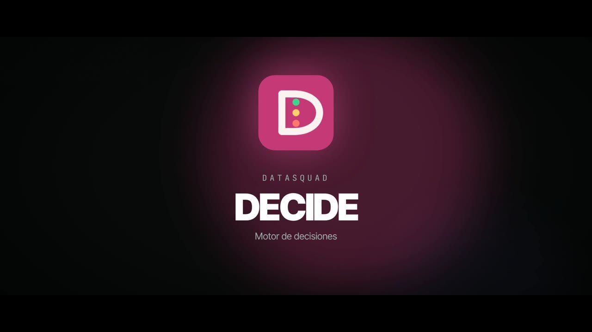
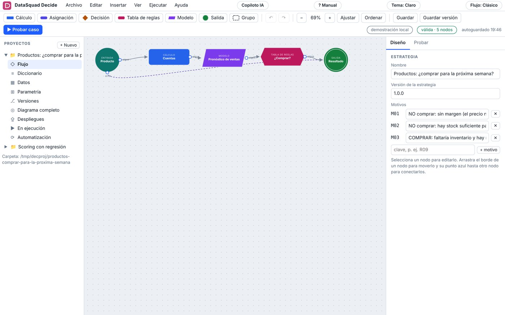
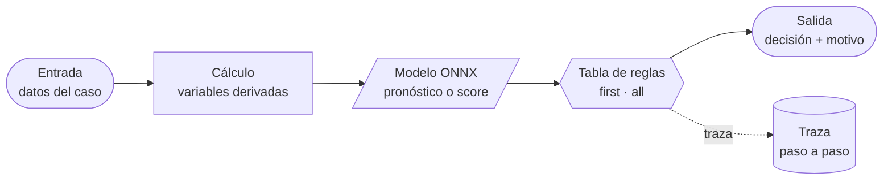
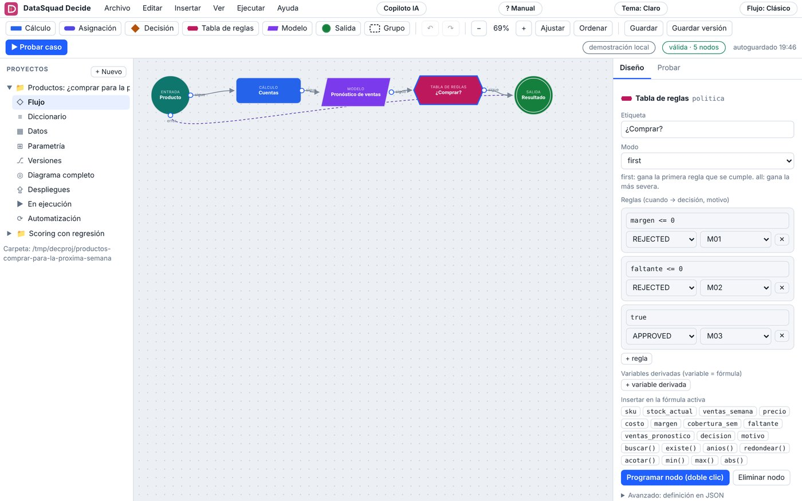
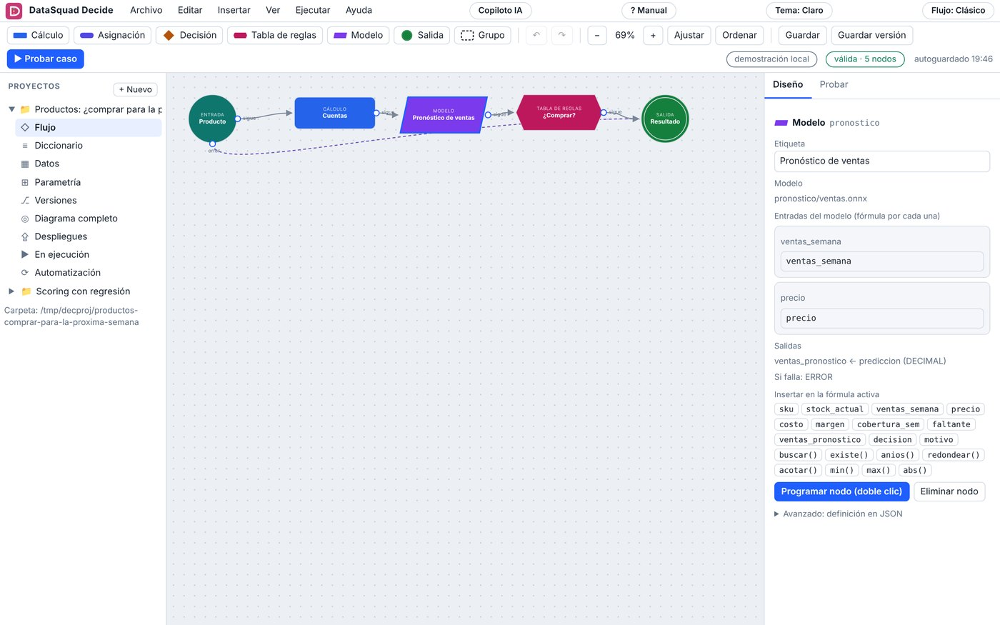
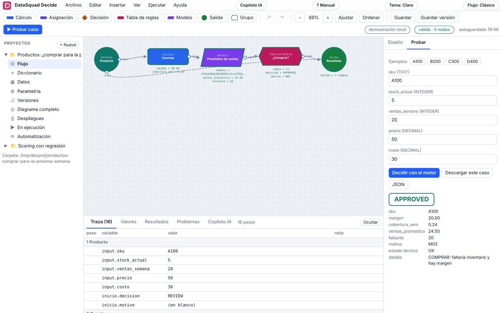
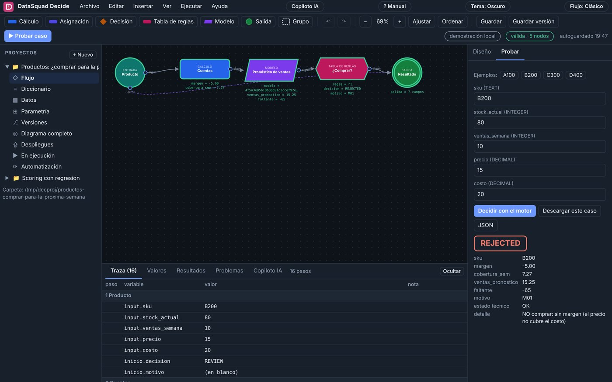

# DataSquad Decide

**Motor de decisiones local, explicable y auditable.**
Reglas, modelos y decisiones en un mismo flujo visual — cada resultado sale con su motivo.

[**Sitio web**](https://datasquad.pages.dev/decide/) ·
[**Descargar**](https://datasquad.pages.dev/suite/) ·
[**Ver la presentación**](https://datasquad.pages.dev/decide/) ·
[**Contacto**](mailto:datasquadoficial@gmail.com)

> [!NOTE]
> Este repositorio es la **ficha pública** de DataSquad Decide: explica qué es, cómo funciona y cómo obtenerlo.
> El código fuente es privado.

  
   Presentación de 51 segundos · clic para verla en el sitio

---

## ¿Qué es?

DataSquad Decide es un **motor de decisiones de escritorio**, pensado para equipos de riesgo,
crédito, retail y operaciones que hoy deciden con cientos de reglas repartidas en hojas de cálculo.

Armas una **estrategia** como un flujo de bloques — entrada, cálculos, modelos, tablas de reglas y salida —,
la pruebas caso por caso y la ejecutas en línea o por lotes. Cada decisión queda **explicada paso a paso**:
qué entró, qué se calculó, qué regla aplicó y por qué.

## Por qué Decide

| | |
|---|---|
| 🔍 **Explicable** | Cada resultado trae su motivo (`M01`, `M02`…) y una traza `nodo.variable` completa. |
| 🧾 **Auditable** | Las versiones publicadas son inmutables y cada ejecución registra la huella SHA-256 que usó. |
| 🖥️ **Local** | Corre en tu equipo o tu infraestructura. Sin servidor, sin base de datos, sin servicios de pago. |
| 🎯 **Determinista** | Mismos datos, misma versión → misma decisión. Aritmética `Decimal` con redondeo explícito. |
| 🧠 **Modelos reales** | Conecta modelos **ONNX** como un nodo más; corren aislados en procesos trabajadores. |
| 🔒 **Seguro por diseño** | Sin `eval` ni `exec`: las fórmulas usan un lenguaje propio (DSE) con parser y verificador de tipos. |

## Cómo funciona

1. **Diseña** el flujo con bloques: Cálculo, Asignación, Decisión, Tabla de reglas, Modelo, Salida y Grupo.
2. **Valida**: el planeador revisa tipos, conexiones y cobertura antes de ejecutar.
3. **Prueba** casos de ejemplo o tus propios datos y revisa la traza.
4. **Versiona y despliega**: guarda versiones inmutables y elige cuál usa la automatización.
5. **Ejecuta** caso por caso, por lotes (Excel, CSV, Parquet) o de forma programada.

## Capturas

<table>
  <tr>
    <td width="50%"> <b>Tabla de reglas</b> — condición, decisión y motivo por renglón.</td>
    <td width="50%"> <b>Modelo como nodo</b> — entradas y salidas del ONNX mapeadas al flujo.</td>
  </tr>
  <tr>
    <td> <b>APPROVED</b> con su motivo y la traza de 16 pasos.</td>
    <td> <b>REJECTED</b> — tema oscuro: el precio no cubre el costo.</td>
  </tr>
</table>

## Funciones

- **Editor visual** con deshacer/rehacer, zoom, grupos y orden automático.
- **Diccionario de variables**, **parametría** (tablas de parámetros desde Excel o JSON) y **datos** de prueba.
- **Probar caso** con traza, valores intermedios y lista de problemas.
- **Lotes** desde Excel, CSV o Parquet, con resultados descargables.
- **Versiones y despliegues**: cada versión es una copia fija; la automatización usa la desplegada.
- **Automatización**: por carpeta (deja archivos y salen decididos) o por horario.
- **Copiloto IA opcional** con Ollama (local) o Claude: ayuda a armar y explicar; nunca toma la decisión.
- **Temas** claro, oscuro y azul.

## Casos de uso

| Industria | Ejemplo |
|---|---|
| **Banca** | Originación de crédito, scorecards y reglas de parametría versionadas y auditables. |
| **Retail** | ¿Comprar o no para la próxima semana? Pronóstico de ventas + reglas de margen e inventario. |
| **Logística** | Asignar prioridad, ruta o almacén con reglas y modelos que aprenden del historial. |

## Arquitectura (resumen)

| Componente | Rol |
|---|---|
| **Decision Studio** | Editor de escritorio: diseño, pruebas, versiones y automatización. |
| **Decision Runtime** | Motor que carga, valida, planea y ejecuta estrategias. Funciona sin el editor. |
| **Contrato v1** | Estrategia en JSON con esquema, huella SHA-256 y versionado semántico. |
| **DSE** | Lenguaje de expresiones con gramática congelada, sin evaluación de código arbitrario. |
| **Trabajadores de modelo** | Procesos aislados que ejecutan ONNX aprobados por huella exacta. |

## Requisitos

- Windows 10 u 11, 64 bits.
- Se instala desde el **lanzador DataSquad** ([descargar](https://datasquad.pages.dev/suite/)).

## Hoja de ruta

| Etapa | Contenido | Estado |
|---|---|---|
| E0–E3 | Contratos, cargador, lenguaje DSE, validación y planeador | ✅ Entregado |
| E4 | Motor: reglas `first`/`all`, errores, resultado, traza, pruebas *golden* | ✅ Entregado |
| E5 | Modelos ONNX y retador (*challenger*) | 🚧 En curso |
| E6 | Endurecimiento, *benchmarks* y revisión de seguridad | ⏳ Pendiente |

## Preguntas frecuentes

<b>¿Mis datos salen de mi computadora?</b>

No. El motor corre localmente. El copiloto IA es opcional; con Ollama también es local.

<b>¿Qué formatos de modelo acepta?</b>

ONNX. Cada modelo se aprueba por su huella SHA-256 exacta antes de poder ejecutarse.

<b>¿Puedo usarlo en mi empresa?</b>

Escríbenos a <a href="mailto:datasquadoficial@gmail.com">datasquadoficial@gmail.com</a> y te contamos las opciones.

## Colabora

¿Tienes una idea, encontraste un error o quieres sumarte? **Toda aportación cuenta**: las propuestas
se revisan, se platican y las que encajan entran en las próximas versiones — con crédito para quien las propuso.

- 💡 [Proponer una idea](../../issues/new?template=idea.yml)
- 🐞 [Reportar un error](../../issues/new?template=error.yml)
- 📧 Escríbenos a [datasquadoficial@gmail.com](mailto:datasquadoficial@gmail.com) para pruebas, alianzas o acceso al código.

Lee la [guía para colaborar](CONTRIBUTING.md).

### Colaboradores

Hecho con <a href="https://contrib.rocks">contrib.rocks</a>.

## Licencia

© 2026 DataSquad. Todos los derechos reservados. DataSquad Decide es software propietario;
este repositorio contiene solo documentación e imágenes del producto. Consulta [LICENSE](LICENSE).

Hecho en México por <a href="https://datasquad.pages.dev">DataSquad</a> · ¡El futuro se predice, con DataSquad se aprende!

